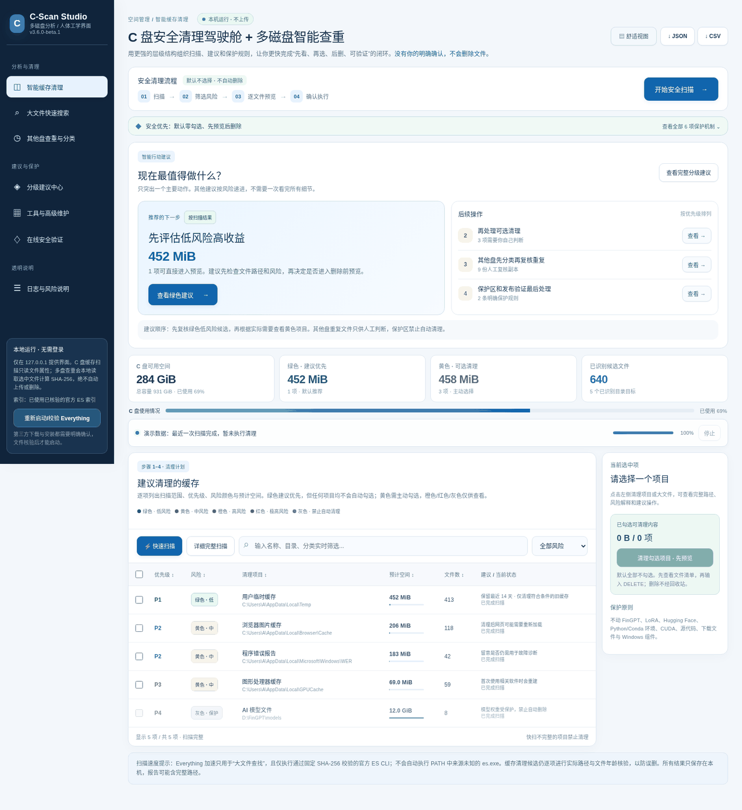
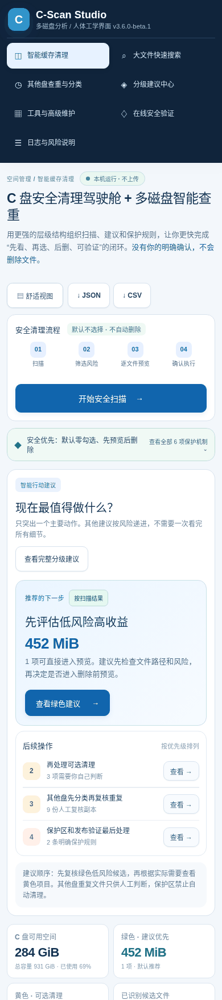
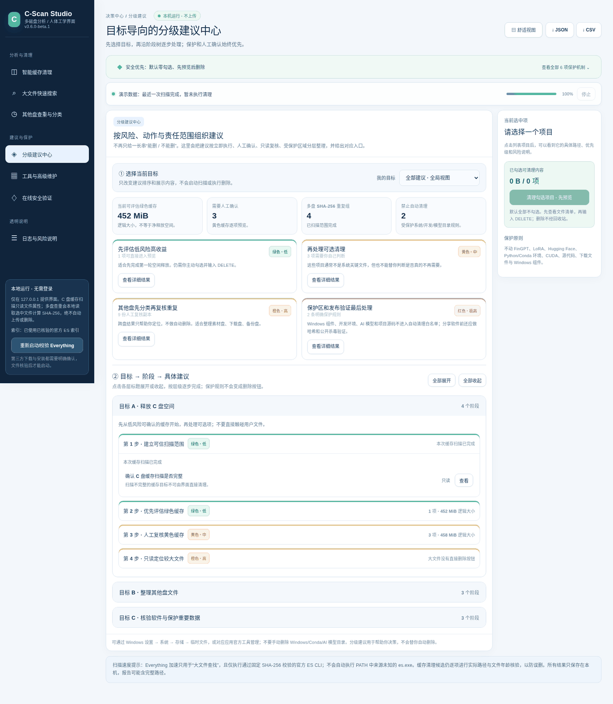

# C-Scan Studio v3.6.0-beta.2 / Windows 安全空间管理与多盘只读分类

**Windows 10 / 11** · 单一启动 BAT · 本地浏览器界面 · 可选 Everything 索引 · 零额外 Python pip 依赖 · 开源可审计

> 这是磁盘扫描与缓存清理工具，不是杀毒软件，也没有“官方无毒认证”。
> 默认只有只读扫描；清理需选中白名单项目、预览提示并键入 `DELETE`。


## v3.6.0-beta.2 升级说明

新增 Ctrl+K / 非输入框下 `/` 快速定位模块（仅跳转、绝不扫描或删除）；缓存候选的绿色/黄色风险计数与逻辑大小估算；一键清空选择不删除；本地服务失联时禁止继续清理操作。多盘分类及重复文件检验只读，原服务器预览凭证与 `DELETE` 强确认不变。

新增模拟浏览器交互回归测试，覆盖 Ctrl+K、风险汇总、双击请求、过期票据与请求结果未知。**如果清理 POST 的响应丢失，不能断言没有执行：请核对日志与磁盘后再做决定。** Windows/Linux CI 运行 Node.js 内建 VM 测试，无需 npm 下载第三方包。

**注意：下方 v3.6 基础截图来自旧版模拟数据，不是 beta.2 新功能的验收截图。** 新版未完成 Windows 真实清理和独立 VirusTotal 检测。

## v3.6 新界面设计 · 截图反馈（模拟数据）

本版本保留原清理与多盘分类引擎，专门把主界面改成**一项主要行动 + 三项次要建议**，减少长期显示的大段文字。







截图使用模拟文件与磁盘数字，不是任何用户电脑的扫描结果。

本版本增加了：① 可展开的安全机制说明；② 任务导航面包屑；③ 舒适/紧凑密度切换；④ 手机上保留文字导航；⑤ 移动端每个清理候选以独立卡片显示，安全复选框和详情入口可用；⑥ 多盘扫描的“选择磁盘 / 分类 / 重复组”快捷步骤栏。

**默认零勾选、清理前的限时预览凭证和 `DELETE`、多盘只读保护，全部保留。** 当前仍为 Beta，没有完成你的 Windows 电脑实机清理验证，也没有本版本的独立 VirusTotal 检测报告。

## 1. 开始使用

1. 下载此版本的 `C_Scan_Studio_v3.6.0-beta.2_Source.zip`（独立版本；通过 CI 后 GitHub 会生成自己的发行附件），使用与实际下载文件对应的 SHA-256 核对，**不能套用 v3.4 或 v3.3 的文件指纹或 VirusTotal 结论**。
2. 解压到例如 `D:\C_Scan_Studio_v3.6.0-beta.2`，不要直接在 ZIP 内运行。
3. 双击根目录唯一的 **`00_启动C-Scan智能清理与安全中心.bat`**。
4. 已有 Python/Anaconda/Miniconda 时直接复用；未找到兼容的 Python 时会按固定 SHA-256 下载官方便携 CPython（需要联网，下载失败则不会清理）。不会修改系统 PATH。
5. 浏览器自动打开 **127.0.0.1** 本地控制台。检查缓存清单和风险颜色；是否清理由你决定。

## 2. 统一界面，原 BAT 功能如何找

| 操作 | v3.6.0-beta.2 图形界面入口 | 说明 |
| --- | --- | --- |
| 扫描 / 详细分析 | 智能缓存清理 | 不删除 |
| 按项目清理 | 智能缓存清理 → 勾选 → `DELETE` | 不能撤销 |
| Python 环境检查 | 工具与高级维护 → Python | 不改环境 |
| 官方完整版 Python | 工具与高级维护 → 可选安装 | 额外两次确认 |
| Everything 与 ES CLI | 工具与高级维护 → Everything | 用户确认、固定官方 SHA-256 |
| 快速查找大文件 | 大文件快速搜索 | 只读，不能删除 |
| 其他盘查重与分类 | 其他盘查重与分类 → 选择盘符 → 只读分析 | 按 SHA-256 查重、智能分类，只给人工处理建议 |
| Defender、数字签名、离线分享 ZIP | 工具与高级维护 → 安全核验 | 按操作分别确认 |
| 在线检测 / 本地哈希 | 在线安全验证 | 永不自动上传 |
| CSV / JSON 报告 | 首页右上角 / 安全验证 | 报告含本机路径，分享前脱敏 |
| 系统高级清理 | 工具与高级维护 → Windows 存储 | 只打开 Windows 官方设置 |

其他启动细节保留在 `internal/`，根目录不再堆叠重复 BAT。

## 3. 安全边界

- **绿色**低风险缓存：推荐优先核对；**黄色**中风险：由用户勾选。
- **橙色/红色/灰色**：只读建议或明确保护，禁止 GUI 自动清理。
- **P1–P4** 是处理优先级，**不代表删除安全性**；风险与优先级分开。
- 清理的文件必须出现在刚完成的扫描快照中，删除前复核路径、大小、修改时间、文件年龄、进程占用情况；拒绝符号链接/联接点。
- 保护 WinSxS、驱动、Windows Installer、回收站、个人文件、FinGPT/LoRA/模型权重、Conda 环境、CUDA 和 Python 虚拟环境。
- 不会发送扫描结果到云端；仅当用户点击 Everything 下载、官方 Python 下载或外部网页时才发生相关访问。
- 完整性检查不是独立信任源；只覆盖列入文件清单的源码，不检测所有未知文件，不能证明没有恶意软件。
- 第三方 Everything 二进制不在默认发行包中。可自选官方下载并校验。

## 4. 朋友如何独立验证

```powershell
Get-FileHash -Algorithm SHA256 -LiteralPath '.\C_Scan_Studio_v3.5.2-beta.1_Source.zip'
```

将 SHA-256 与 GitHub Releases 的发行信息或独立渠道公开的校验值核对。检查 `Actions` 自动测试、`Security` CodeQL 检查、发行附件的 GitHub Artifact Attestation；使用 Microsoft Defender 或 VirusTotal / MetaDefender / Jotti 主动检测发行包。**任何单项通过都不等于软件已认证无毒。**

## 5. 给开发者

无需安装 Python 第三方依赖。测试：

```shell
python -m unittest discover -s tests
python -m unittest discover -s tests_v3
python -m unittest discover -s tests_v31
python -m unittest discover -s tests_v32
python -m unittest discover -s tests_v33
python -m unittest discover -s tests_v34
python scripts/build_release.py --outdir ../cscan-dist
```

完整 GitHub 发布步骤见 `docs/GITHUB_PUBLISH_CN.md`，安全披露见 `SECURITY.md`，开源许可见 `LICENSE`，第三方声明见 `NOTICE.md`。

## 6. 尚未完成的真实验证

本项目在隔离环境执行回归测试，但**不宣称已在你的 Windows 电脑上通过真实文件清理、Defender 检测或 Everything 索引联调**。GitHub Actions 绿色状态与病毒扫描 URL 只有在真实执行后才可以公开引用。

## 7. v3.3.1 Windows encoding hotfix

- Windows 启动 BAT 和 GitHub CI 强制使用 UTF-8，避免在 cp1252 控制台输出中文时异常退出。
- GitHub Release 只有当同一主分支提交的 Windows/Linux CI 和 CodeQL **实际成功**后才自动创建；附 SHA-256 和 GitHub Artifact Attestation。
- 任何 GitHub 检查都不是第三方杀毒证书；VirusTotal / MetaDefender 结果必须通过外部实际扫描取得。

## v3.4 测试版安全改进（v3.3.1 稳定版保留）

- **默认零勾选**：绿色缓存是推荐分类，但不自动代替用户选择。
- **强制删除前预览**：只有已完整扫描、在白名单内且未被禁止的类别才可生成预览；服务端返回只读清理清单、样本路径和有效期 120 秒的一次性凭证。`DELETE` 不能绕过该步骤。
- **逐文件再次核对**：预览不等于保证删除；文件元数据、进程状态和路径安全会在删除时再次检查。删除不经回收站。
- **Everything 可信来源**：不再自动从 PATH 或其他目录运行未经本工具 SHA-256 验证的 `es.exe`。
- **公开核验**：已有的 [v3.3.1 稳定版](https://github.com/IvanChen-ctrl/c-scan-studio/releases/tag/v3.3.1) 保持不变，新预发行版产生**新的 SHA-256**，以前的 VirusTotal 报告不能当成新版查毒结果。
- **发布建议**：请先在 Windows 本机只读扫描测试，再进行真实删除测试。当前不能宣称经过实机验证。


## v3.4.0-beta.2 增强：完整候选路径预览 + 清理后净空间比较

- 清理预览窗口新增 **全量候选文件分页**（每页 50 条），来自既有扫描快照；不会从浏览器读取任意路径。
- 分页接口要求本地同源会话和短时预览凭证，分页不会续期。取消、重新扫描或实际执行后，旧凭证立即失效。
- 清理结束后分别展示 **成功删除文件的逻辑大小**、**执行前 C 盘可用空间**及**执行后净空间变化**。后者可能受到其他程序同时写入磁盘影响，不表示独占回收量。
- 初始默认不勾选任何清理项；预览未能成功读取第一页时，最终删除按钮保持不可用。
- 注意：仅通过模拟测试、GitHub CI 和代码扫描的情况，不能代替在真实 Windows 系统上的清理测试。

Windows 实机验收步骤见 `docs/WINDOWS_TEST_CHECKLIST_CN.md`。

## 已发布版本与第三方安全核验（2026-10-31）

- **[稳定版 v3.3.1](https://github.com/IvanChen-ctrl/c-scan-studio/releases/tag/v3.3.1)**：保留先前的 VirusTotal 文件报告，适合未参与测试的朋友先使用只读扫描。
- **[预发布 v3.4.0-beta.2](https://github.com/IvanChen-ctrl/c-scan-studio/releases/tag/v3.4.0-beta.2)**：发行 ZIP 的 SHA-256 是 `dc9d63c1e85ae7a7ffb28e3cc695e1c3a2976c0d7b83f9cd76bbf1397e9bee66`，为 **GitHub Release 附件**而不是任何同名的预合并测试包。
- [beta.2 的独立验证记录](docs/SECURITY_VERIFICATION_v3.4.0-beta.2.md)列出了真实 CI、CodeQL、构建证明、重建结果和未完成的病毒扫描。
- [给朋友的安全核验手册](docs/FRIENDS_VERIFY_CN.md)提供哈希校验、GitHub 构建证明及可选第三方病毒扫描步骤。
- beta.2 **尚无已独立核实的 VirusTotal 报告，也没有真实 Windows 清理验收**；旧版 v3.3.1 的检测记录不能用于 beta.2。
- 此后更新的 `main` 包含文档变更，重新构建的 ZIP SHA-256 可能变化；请以**固定的 Release 附件**作为独立检测和对外分享对象。

## v3.5.0-beta.1 新功能：其他盘查重与智能分类（测试版）

**此版本测试包与 GitHub 既有 v3.4.0-beta.2 Release 不同，必须独立核对 SHA-256。** 既有 v3.3.1 稳定版和 v3.4.0-beta.2 预发布版不替换、不重写。

- 左侧 **「其他盘查重与分类」** → 主动勾选 D:～Z: → 选择最小重复文件阈值 → 开始只读分析；支持多个本机磁盘一起比较同内容副本。
- 只把完整 SHA-256 相同的非硬链接文件列为重复组；按备份/项目/模型/数据库等保护规则提出**人工复核建议**，没有自动删除、移动或整理文件的功能。
- 智能分类采用透明可解释的扩展名/文件名规则，可按类别分页浏览完整文件清单并导出 JSON/CSV，**不声称使用 AI 模型理解个人文件**。
- 首次启动时不再自动执行 C 盘扫描，所有磁盘任务都需要明确点击。索引/分类/文件哈希都在本机，不自动上传。
- 时间、数量、哈希字节和运行时长有上限；结果标明是否完整，理论重复大小并不是可直接回收空间。
- 操作说明见 [多盘查重简明手册](docs/MULTIDRIVE_DUPLICATES_GUIDE_CN.md)；更新日志见 [v3.5 发布说明](docs/RELEASE_NOTES_v3.5.md)。

**验收状态：** 目前只通过隔离环境模拟扫描与静态浏览器布局验证，尚无用户 Windows 实机 NTFS/USB 长时扫描及本版本独立 VirusTotal 报告。向朋友推荐时请优先使用验证完整的 v3.3.1 稳定版。

## v3.5.2-beta.1 — 分级建议与多盘分类树

- 主页按目标显示**优先清理、人工确认、只读复核、受保护文件**。
- 分级建议页按**目标 → 阶段 → 建议事项**展开，便于分步操作。
- 其他盘分类按**内容族群（按扩展名） → 文件类别 → 子类 → 盘符 → 文件清单**浏览。
- 所有类别层级为本地文件扩展名规则分类，不进行内容理解，也不向云端上传文件。
- 分类页只返回扫描结果里的聚合统计；单个路径只通过原有带令牌的本地分页接口读取。
- 多盘模块不提供删除、移动、重命名或批量处理功能。
- 详情见 [v3.5.2 发布说明](docs/RELEASE_NOTES_v3.5.2.md)。

[树状分类与分级建议简明手册](docs/TREE_GUIDE_CN.md)。

新版界面的人体工学说明见 [v3.6 发布说明](docs/RELEASE_NOTES_v3.6.md)。
